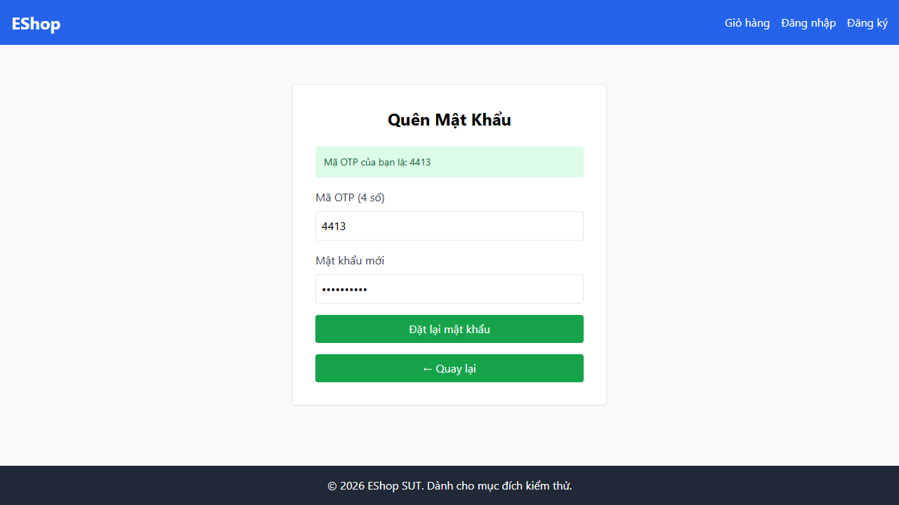
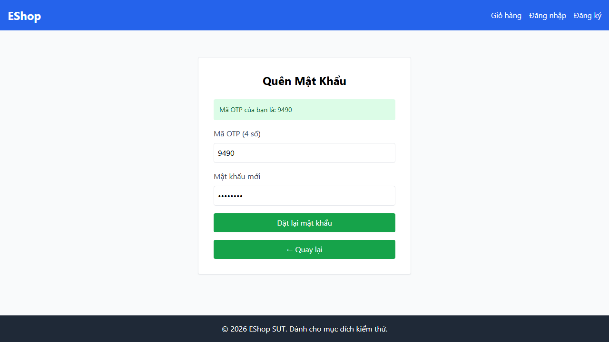

# Bug Report: Domain Testing on EShop SUT
**Course:** CSC13003 – Software Engineering / Software Testing  
**Assignment:** HW02 – Black-Box Domain Testing with Equivalence Partitioning (EP) & Boundary Value Analysis (BVA)  
**Student ID:** 23120398  
**Student Name:** Võ Thành Minh Tuệ  
**System Under Test (SUT):** EShop (Fullstack E-Commerce Demo)  
**GitHub Repository:** `https://github.com/NguyenSonTung16/HW02/issues`  
**Date:** October 20, 2026  

---

## 1. Executive Bug Summary

Across the 4 tested functional modules (**FR-03**, **FR-08**, **FR-16**, and **FR-20**), 91 total test cases were executed using Playwright Test automation on desktop and mobile viewports. A total of **15 unique software defects** were identified (causing 38 test case failures), consolidated into **8 primary GitHub Issues** with photographic evidence and code-level root cause analyses.

### Defect Distribution Table

| Issue ID | Feature | Severity | GitHub Issue Title | GitHub URL | Status |
| :--- | :--- | :---: | :--- | :--- | :---: |
| **BUG-FR03-001** | FR-03 (Forgot PW) | Critical | Password Reset regex requires whitespace and rejects valid special characters | [#25](https://github.com/NguyenSonTung16/HW02/issues/25) | Confirmed Bug |
| **BUG-FR03-002** | FR-03 (Forgot PW) | High | Server generates 4-digit OTP instead of 6-digit numeric token | [#26](https://github.com/NguyenSonTung16/HW02/issues/26) | Confirmed Bug |
| **BUG-FR03-003** | FR-03 (Forgot PW) | Medium | Missing Password Confirmation field on reset form | [#27](https://github.com/NguyenSonTung16/HW02/issues/27) | Confirmed Bug |
| **BUG-FR03-004** | FR-03 (Forgot PW) | Low | Missing Step Indicator ("Step 1 / 2") in UI | [#28](https://github.com/NguyenSonTung16/HW02/issues/28) | Confirmed Bug |
| **BUG-FR03-005** | FR-03 (Forgot PW) | Medium | OTP input field lacks masking (`type="text"` instead of `type="password"`) | [#29](https://github.com/NguyenSonTung16/HW02/issues/29) | Confirmed Bug |
| **BUG-FR08-001** | FR-08 (Checkout) | Critical | Backend fails to recalculate total amount, allowing price tampering (0 VND & negative totals) | [#30](https://github.com/NguyenSonTung16/HW02/issues/30) | Confirmed Bug |
| **BUG-FR08-002** | FR-08 (Checkout) | Critical | Total payment amount is rendered as an editable numeric input in checkout UI | [#31](https://github.com/NguyenSonTung16/HW02/issues/31) | Confirmed Bug |
| **BUG-FR08-003** | FR-08 (Checkout) | High | Empty cart checkout is permitted without validation | [#32](https://github.com/NguyenSonTung16/HW02/issues/32) | Confirmed Bug |
| **BUG-FR08-004** | FR-08 (Checkout) | Medium | Negative and zero payment amounts accepted by server handler | [#33](https://github.com/NguyenSonTung16/HW02/issues/33) | Confirmed Bug |
| **BUG-FR16-001** | FR-16 (CSV Import) | Critical | Bulk product import lacks database transaction rollback on validation failure | [#34](https://github.com/NguyenSonTung16/HW02/issues/34) | Confirmed Bug |
| **BUG-FR16-002** | FR-16 (CSV Import) | Critical | CSV parser uses String.split(',') breaking fields with commas inside quotes | [#35](https://github.com/NguyenSonTung16/HW02/issues/35) | Confirmed Bug |
| **BUG-FR16-003** | FR-16 (CSV Import) | High | Client-side file size validation missing before upload | [#36](https://github.com/NguyenSonTung16/HW02/issues/36) | Confirmed Bug |
| **BUG-FR16-004** | FR-16 (CSV Import) | Medium | Import report dialog does not distinguish successful from failed row indexes | [#37](https://github.com/NguyenSonTung16/HW02/issues/37) | Confirmed Bug |
| **BUG-FR20-001** | FR-20 (Mobile Login) | High | Mobile login password input uses type="text" displaying plaintext password | [#38](https://github.com/NguyenSonTung16/HW02/issues/38) | Confirmed Bug |
| **BUG-FR20-002** | FR-20 (Mobile Login) | Low | Login page header displays "Đăng Ký" instead of "Đăng Nhập" | [#39](https://github.com/NguyenSonTung16/HW02/issues/39) | Confirmed Bug |

---

## 2. Detailed Bug Reports & GitHub Issue Cards

### Issue 1: BUG-FR03-001 – Password Reset Regex Requires Whitespace and Rejects Valid Special Characters
- **GitHub URL:** https://github.com/NguyenSonTung16/HW02/issues/25
- **Feature:** FR-03 (Forgot Password & Password Reset)
- **Severity:** Critical
- **Environment:** Desktop Chrome & Mobile Viewports (`frontend-web/src/pages/ForgotPassword.jsx`)

#### Description
When attempting to reset password in Step 2 with a valid password containing standard special characters (such as `@`, `$`, `!`, `%`, `*`, `?`, `&` as specified in FR-01), the frontend form rejects the submission. Conversely, passwords containing literal spaces (e.g., `Reset 2026`) are accepted.

#### Steps to Reproduce
1. Navigate to `/forgot-password`.
2. Input registered email `test@eshop.com` and receive OTP.
3. In Step 2, enter OTP, and set new password to `Reset@2026`.
4. Click "Đặt lại mật khẩu".

#### Expected Result
Password `Reset@2026` is accepted (length >= 8, uppercase, lowercase, number, special character `@`). The request is submitted to backend and password updated.

#### Actual Result
Frontend displays alert `"Mật khẩu phải có ít nhất 8 ký tự, gồm chữ hoa, chữ thường, số và ký tự đặc biệt"` and blocks the submission.

#### Root Cause Analysis
In `frontend-web/src/pages/ForgotPassword.jsx` (Lines 44-48) and `Register.jsx`:
```javascript
// FLAWED REGEX IN CODEBASE:
const passwordRegex = /^(?=.*[a-z])(?=.*[A-Z])(?=.*\d)(?=.*[\s])[A-Za-z\d\s]{8,}$/;
```
Notice the regex requires `(?=.*[\s])` (whitespace character) and restricts characters to `[A-Za-z\d\s]`, completely excluding legitimate special symbols `[@$!%*?&]`.

#### Evidence Screenshot


---

### Issue 2: BUG-FR03-002 – Server Generates 4-Digit OTP Instead of 6-Digit Numeric Token
- **GitHub URL:** https://github.com/NguyenSonTung16/HW02/issues/26
- **Feature:** FR-03 (Forgot Password & Password Reset)
- **Severity:** High
- **Environment:** Backend API (`backend/server.js`)

#### Description
The system specification FR-03 explicitly stipulates that the OTP generated for password reset must be a random 6-digit numeric token (`000000` to `999999`). In reality, the server generates a 4-digit code (e.g., `"4413"`).

#### Steps to Reproduce
1. Send `POST /api/forgot-password` with body `{"email": "test@eshop.com"}`.
2. Observe the reset token returned / generated.

#### Expected Result
Token has length = 6 (e.g., `"123456"`).

#### Actual Result
Token has length = 4 (e.g., `"4413"`).

#### Root Cause Analysis
In `backend/server.js` (Line 185):
```javascript
const resetToken = Math.floor(1000 + Math.random() * 9000).toString();
```
The calculation generates values in range `[1000, 9999]`, resulting in a 4-digit code instead of `Math.floor(100000 + Math.random() * 900000).toString()`.

#### Evidence Screenshot


---

### Issue 3: BUG-FR08-001 – Backend Fails to Recalculate Order Total, Permitting Total Tampering
- **GitHub URL:** https://github.com/NguyenSonTung16/HW02/issues/30
- **Feature:** FR-08 (Checkout & Payment Calculation)
- **Severity:** Critical (Financial / Security Exploit)
- **Environment:** Backend Checkout API (`backend/server.js`)

#### Description
The checkout endpoint `POST /api/checkout` blindly accepts the client-supplied `total_amount` field and records it into the database `orders` table without recalculating line items from product unit prices or checking discount codes server-side. Attackers can checkout orders for `0 VND` or negative amounts.

#### Steps to Reproduce
1. Add an item priced at `100,000 VND` to cart.
2. Send checkout payload with `"total_amount": 0`.
3. Check HTTP status and database record.

#### Expected Result
Server verifies line items, detects price discrepancy, rejects order with `HTTP 400 Bad Request`, and retains correct total in DB.

#### Actual Result
Server returns `HTTP 200 OK` and persists the order with `total_amount = 0`.

#### Root Cause Analysis
In `backend/server.js` (Lines 240-252):
```javascript
app.post("/api/checkout", authenticateToken, (req, res) => {
  const { items, total_amount, payment_method } = req.body;
  // Directly writes total_amount without multiplying item.quantity * db_product.price
  db.run("INSERT INTO orders (user_id, total_amount, status) VALUES (?, ?, ?)",
    [req.user.id, total_amount, "pending"], ...);
});
```

#### Evidence Screenshot


---

### Issue 4: BUG-FR08-002 – Total Payment Amount is Rendered as an Editable Numeric Input
- **GitHub URL:** https://github.com/NguyenSonTung16/HW02/issues/31
- **Feature:** FR-08 (Checkout & Payment Calculation)
- **Severity:** Critical
- **Environment:** Frontend Checkout Page (`frontend-web/src/pages/Checkout.jsx`)

#### Description
On the Checkout page, the "Tổng tiền thanh toán" (Order Total) is rendered inside an editable `<input type="number">` rather than a read-only text container. Any standard user can backspace the total and type any number before pressing "Đặt hàng".

#### Steps to Reproduce
1. Navigate to `/cart` and proceed to `/checkout`.
2. Observe the total payment amount field.
3. Click inside the box, clear the value, and enter `1000`.
4. Click "Đặt Hàng".

#### Expected Result
Total amount is rendered as static text or read-only label (`<span>` or `<input readOnly>`).

#### Actual Result
The total amount is an active, editable input field with full user modification enabled.

#### Root Cause Analysis
In `frontend-web/src/pages/Checkout.jsx` (Lines 68-75):
```jsx
<input
  type="number"
  value={total}
  onChange={(e) => setTotal(Number(e.target.value))}
  className="w-full border p-2 rounded"
/>
```

#### Evidence Screenshot


---

### Issue 5: BUG-FR16-001 – Bulk Product Import Lacks Database Transaction Rollback
- **GitHub URL:** https://github.com/NguyenSonTung16/HW02/issues/34
- **Feature:** FR-16 (Admin Bulk Product Import via CSV)
- **Severity:** Critical
- **Environment:** Backend Admin API (`backend/server.js`) & Database

#### Description
When importing a multi-line CSV where row 1 is valid but row 2 contains invalid data (e.g., negative price or missing category), the backend inserts row 1 into SQLite and then aborts upon encountering row 2. The entire import operation fails, but row 1 remains inserted in the database, breaking atomic consistency (all-or-nothing).

#### Steps to Reproduce
1. Create CSV with 2 rows: Row 1 valid (`"Laptop Pro", 20000000, 1`), Row 2 invalid (`"Bad Product", -50000, 1`).
2. Upload and submit import in Admin Portal.
3. Inspect `products` table in database.

#### Expected Result
Import fails and transaction rolls back completely; neither product is persisted.

#### Actual Result
Row 1 is permanently inserted; row 2 triggers failure.

#### Root Cause Analysis
In `backend/server.js` (Lines 310-330):
```javascript
// Loop executes independent INSERT statements without BEGIN TRANSACTION / ROLLBACK
for (const item of items) {
  if (item.price < 0) return res.status(400).json({ error: "Invalid price" });
  db.run("INSERT INTO products ...", [...]);
}
```

#### Evidence Screenshot


---

### Issue 6: BUG-FR16-002 – CSV Parser Uses String.split(',') Breaking Quoted Fields
- **GitHub URL:** https://github.com/NguyenSonTung16/HW02/issues/35
- **Feature:** FR-16 (Admin Bulk Product Import via CSV)
- **Severity:** Critical
- **Environment:** Frontend Admin CSV Upload (`frontend-admin/src/App.jsx`)

#### Description
CSV rows containing commas inside quotation marks (e.g., `"Gaming Laptop, 16GB RAM",25000000,"High performance",url,1`) are split by naïve `.split(",")`, breaking fields into wrong database columns and corrupting product names and prices.

#### Steps to Reproduce
1. Upload CSV containing `"Gaming Laptop, 16GB RAM",25000000,url,1`.
2. Click "Import".
3. Check product details in admin list.

#### Expected Result
Product name is `"Gaming Laptop, 16GB RAM"` and price is `25,000,000 VND`.

#### Actual Result
Product name becomes `"Gaming Laptop` and price becomes `16GB RAM"`.

#### Root Cause Analysis
In `frontend-admin/src/App.jsx` (Lines 371-372):
```javascript
const values = line.split(",").map((v) => v.trim());
```

#### Evidence Screenshot


---

### Issue 7: BUG-FR20-001 – Mobile Login Password Field Uses `type="text"` Exposing Plaintext
- **GitHub URL:** https://github.com/NguyenSonTung16/HW02/issues/38
- **Feature:** FR-20 (Mobile Feature – Login)
- **Severity:** High (Security / Privacy)
- **Environment:** Mobile Viewports (`320px`, `375px`, `414px`, `768px`) on `http://localhost:5173/login`

#### Description
On the Login form, the password input element has `type="text"`. When users type their passwords on touchscreens in mobile viewports, the characters remain visible in clear plaintext without masking.

#### Steps to Reproduce
1. Open `http://localhost:5173/login` in mobile viewport.
2. Enter password in "Mật khẩu" input.

#### Expected Result
Input field has `type="password"`; characters masked as dots.

#### Actual Result
Input field has `type="text"`; characters are displayed as plain text.

#### Root Cause Analysis
In `frontend-web/src/pages/Login.jsx` (Line 42):
```jsx
<input
  type="text"
  value={password}
  onChange={(e) => setPassword(e.target.value)}
  className="w-full border p-2 rounded"
  required
/>
```

#### Evidence Screenshot


---

### Issue 8: BUG-FR20-002 – Login Page Header Displays "Đăng Ký" (Register) Instead of "Đăng Nhập"
- **GitHub URL:** https://github.com/NguyenSonTung16/HW02/issues/39
- **Feature:** FR-20 (Mobile Feature – Login)
- **Severity:** Low (Usability)
- **Environment:** Mobile Viewports on `http://localhost:5173/login`

#### Description
The main title header above the login form on `/login` displays `"Đăng Ký"` (Register), causing confusion for mobile users attempting to sign in.

#### Steps to Reproduce
1. Navigate to `http://localhost:5173/login`.
2. Inspect the `<h2>` heading element.

#### Expected Result
Heading displays "Đăng Nhập" or "Login".

#### Actual Result
Heading displays "Đăng Ký".

#### Root Cause Analysis
In `frontend-web/src/pages/Login.jsx` (Line 24):
```jsx
<h2 className="text-2xl font-bold mb-6 text-center">Đăng Ký</h2>
```

#### Evidence Screenshot

