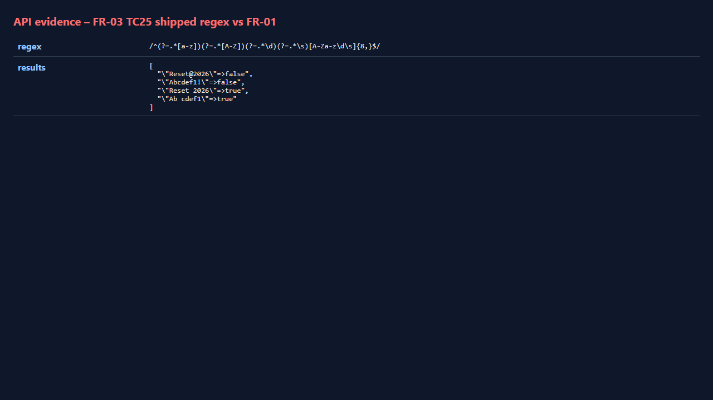
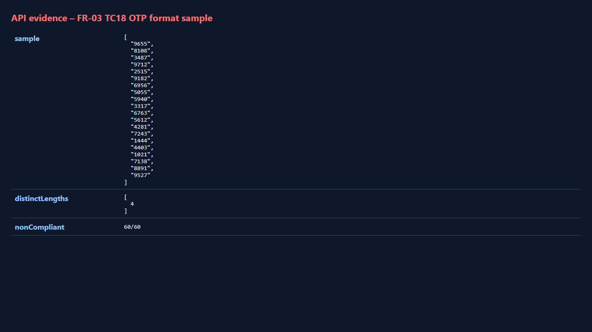
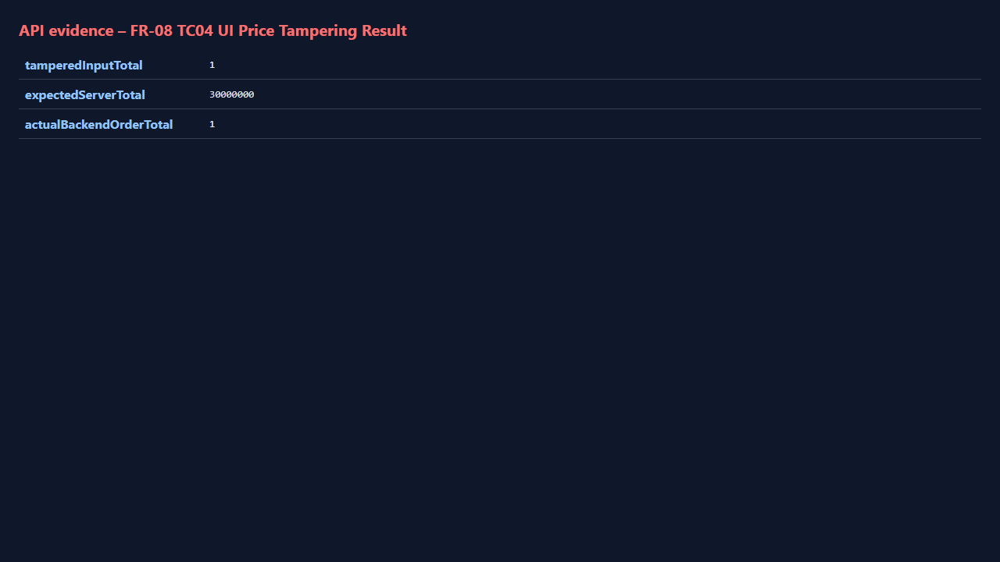
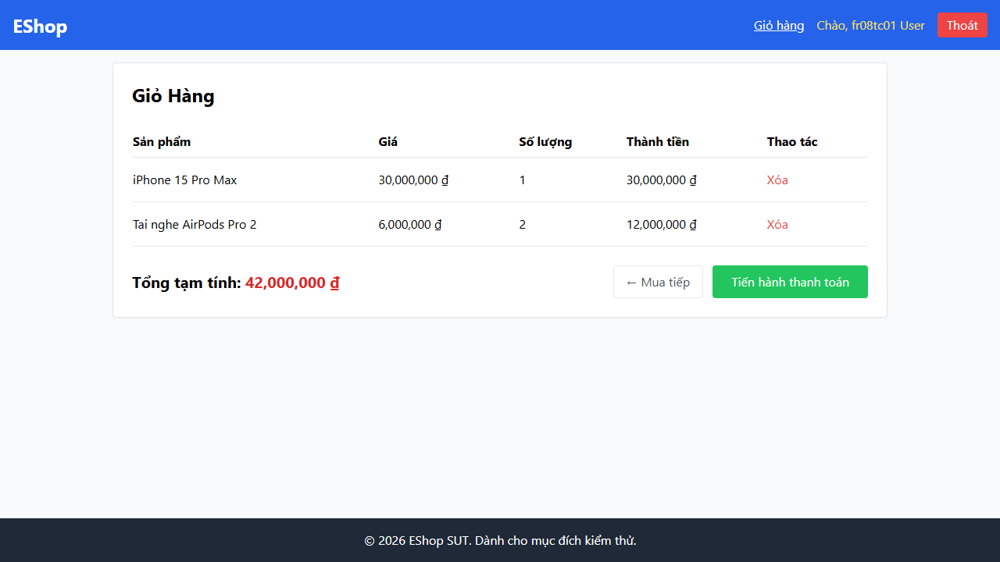
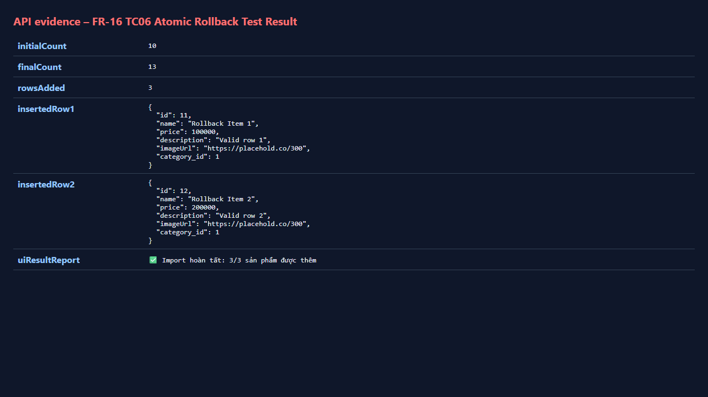
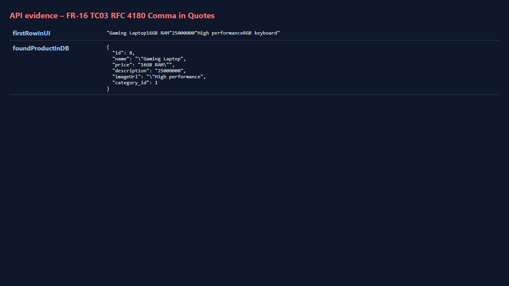
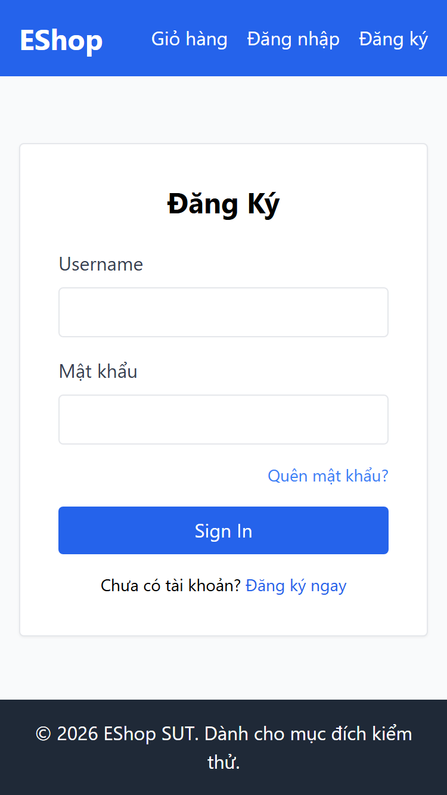

# Software Testing Report: Domain Testing (EP & BVA) on EShop SUT
**Course:** CSC13003 – Software Engineering / Software Testing  
**Assignment:** HW02 – Black-Box Domain Testing with Equivalence Partitioning (EP) & Boundary Value Analysis (BVA)  
**Student ID:** 23120398  
**Student Name:** Võ Thành Minh Tuệ  
**System Under Test (SUT):** EShop (Fullstack E-Commerce Demo)  
**Target Features:** 
1. `FR-03`: Forgot Password & OTP Password Reset (2-Step Workflow)
2. `FR-08`: Checkout & Payment Calculation
3. `FR-16`: Admin Bulk Product Import via CSV
4. `FR-20`: Mobile Feature – Login (Responsive Web on Touch & Mobile Viewports)  
**Test Automation Framework:** Playwright Test (TypeScript)  
**Execution Environment:** Node.js v22.17.1, Chromium (Desktop 1280x720, Mobile 320x568, 375x667, 414x896, Tablet 768x1024), SQLite 3  
**Date of Execution:** October 20, 2026

---

## Executive Summary

| Metric | FR-03 (Forgot PW) | FR-08 (Checkout) | FR-16 (CSV Import) | FR-20 (Mobile Login) | Total Suite |
| :--- | :---: | :---: | :---: | :---: | :---: |
| **Total Test Cases Designed** | 36 | 12 | 11 | 32 (8 x 4 viewports) | **91** |
| **Test Cases Executed** | 36 | 12 | 11 | 32 | **91** |
| **Passed (Spec Compliant)** | 19 | 5 | 5 | 24 | **53 (58.2%)** |
| **Failed (Bugs Discovered)** | 17 | 7 | 6 | 8 (2 bugs x 4 viewports) | **38 (41.8%)** |
| **Unique Critical / High Defects** | 5 | 4 | 4 | 2 | **15 Unique Bugs** |

---

## Feature 1: FR-03 – Forgot Password & OTP Password Reset

### 1. Specification & Domain Model Analysis
- **Step 1 (Request OTP):**
  - Input: `email` (string).
  - Output: Random 6-digit numeric OTP (`000000` to `999999`, exact width = 6) sent via email (demo: rendered on UI).
  - UI Controls: Step Indicator (`"Step 1 / 2"` or `"Bước 1 / 2"`), `"Back to Login"` navigation control.
- **Step 2 (Reset Password):**
  - Inputs: `OTP` (6 digits), `New Password`, `Confirm New Password`.
  - Constraints:
    - `New Password` must satisfy FR-01: length >= 8, at least 1 uppercase, 1 lowercase, 1 digit, and 1 special character from `{@, $, !, %, *, ?, &}`.
    - `Confirm New Password` must match `New Password` exactly.
    - `OTP` is strictly bound to the requesting email account (cross-account usage prohibited).

---

### 2. Task 1 – Equivalence Partitioning (EP) Walkthrough

#### Table 1: Condition Breakdown Table (FR-03)
| Condition | Valid Equivalence Classes | Invalid Equivalence Classes |
| :--- | :--- | :--- |
| **Email Registration** | Registered email in database | Unregistered email |
| **Email Format** | Valid email syntax (`user@domain.com`) | Malformed syntax / Empty string |
| **OTP Value** | Exact matching OTP issued for account | Non-matching OTP / Expired OTP / Reused OTP / Cross-account OTP |
| **OTP Format** | Exactly 6 numeric digits (`000000`-`999999`) | Length != 6 / Non-numeric characters / Empty |
| **New Password Length** | Length >= 8 characters | Length < 8 characters |
| **New Password Composition** | Contains [A-Z], [a-z], [0-9], and [!@$%*?&] | Missing [A-Z] / Missing [a-z] / Missing [0-9] / Missing special char |
| **Password Confirmation** | `Confirm Password == New Password` | `Confirm Password != New Password` / Empty confirmation |
| **UI Controls** | Step indicator and Back to Login rendered | Missing step indicator / Missing back button |

#### Table 2: Complete Set of Partitions (FR-03)
| EC ID | Input / Output Variable | Equivalence Class Description | Type |
| :--- | :--- | :--- | :--- |
| **EC01** | `email` | Registered email address in database | Valid |
| **EC02** | `email` | Unregistered email address | Invalid |
| **EC03** | `email` | Empty string (`""`) | Invalid |
| **EC04** | `email` | Malformed email string (missing `@` or domain) | Invalid |
| **EC05** | `OTP` | Valid 6-digit OTP issued for the requesting email | Valid |
| **EC06** | `OTP` | Wrong numeric OTP (not matching database token) | Invalid |
| **EC07** | `OTP` | OTP issued for Account A used to reset Account B | Invalid |
| **EC08** | `OTP` | Empty string (`""`) | Invalid |
| **EC09** | `OTP` | Non-numeric string (e.g., `"12ab56"`) | Invalid |
| **EC10** | `New Password` | Length >= 8, contains uppercase, lowercase, digit, and allowed special character | Valid |
| **EC11** | `New Password` | Length < 8 characters | Invalid |
| **EC12** | `New Password` | Missing uppercase character | Invalid |
| **EC13** | `New Password` | Missing lowercase character | Invalid |
| **EC14** | `New Password` | Missing numeric digit | Invalid |
| **EC15** | `New Password` | Missing special character (alphanumeric only) | Invalid |
| **EC16** | `New Password` | Special character is only whitespace (`\s`) | Invalid |
| **EC17** | `Confirm Password` | Matches `New Password` exactly | Valid |
| **EC18** | `Confirm Password` | Mismatched string | Invalid |
| **EC19** | `Step Indicator` | Displays `"Step 1 / 2"` and `"Step 2 / 2"` | Valid Output |
| **EC20** | `Navigation` | "Back to Login" button present and redirects to `/login` | Valid Output |

---

### 3. Task 1 – Equivalence Partitioning Test Execution Tables (FR-03)

#### Table 3A: Minimum Set of EP Test Cases (FR-03)
| #TC | Partitions Tested | Concrete Inputs | Expected Output | Actual Output (Observed) | Status |
| :--- | :--- | :--- | :--- | :--- | :---: |
| **TC01** | EC01, EC05, EC10, EC17 | `email`="test@eshop.com", `OTP`=issued, `PW`="Reset@2026", `Confirm`="Reset@2026" | Reset successful; 6-digit OTP; Redirect to `/login` | OTP="4413" (len 4); No Confirm field; PW rejected by regex | **FAIL** |
| **TC02** | EC02 | `email`="nobody@eshop.com" | Error: User not found; No OTP issued | `dialog="Lỗi: User not found"; OTP shown=false` | **PASS** |
| **TC03** | EC03 | `email`="" | HTML5 / UI validation blocks submit | `API calls=0; validationMessage="Please fill out this field."` | **PASS** |
| **TC04** | EC04 | `email`="not-an-email" | Rejected; No OTP issued | `input type="text"; API calls=1; dialog="Lỗi: User not found"` | **PASS** |
| **TC05** | EC06 | `OTP`="999999" (wrong), valid PW | HTTP 400 Bad Request; Old PW unchanged | `HTTP 400 {"error":"Invalid token or email"}; old password retained` | **PASS** |
| **TC06** | EC07 | `OTP` of User A used for User B | HTTP 400 Bad Request; Account B unchanged | `HTTP 400 {"error":"Invalid token or email"}; B old password retained` | **PASS** |
| **TC07** | EC08 | `OTP`="" | HTTP 400 Bad Request | `HTTP 400 {"error":"Invalid token or email"}` | **PASS** |
| **TC08** | EC09 | `OTP`="12ab56" | HTTP 400 Bad Request | `HTTP 400 {"error":"Invalid token or email"}` | **PASS** |
| **TC09** | EC11 | `PW`="Ab@1xyz" (7 chars) | Blocked by UI validation | `dialog="(no dialog)"; password changed=false` | **PASS** |
| **TC10** | EC12 | `PW`="reset@2026" (no upper) | Blocked by UI validation | `dialog="(no dialog)"; password changed=false` | **PASS** |
| **TC11** | EC13 | `PW`="RESET@2026" (no lower) | Blocked by UI validation | `dialog="(no dialog)"; password changed=false` | **PASS** |
| **TC12** | EC14 | `PW`="Reset@Pass" (no digit) | Blocked by UI validation | `dialog="(no dialog)"; password changed=false` | **PASS** |
| **TC13** | EC15 | `PW`="Reset2026" (no special) | Blocked by UI validation | `dialog="(no dialog)"; password changed=false` | **PASS** |
| **TC14** | EC16 | `PW`="Reset 2026" (space only) | Blocked (whitespace not allowed special char) | `dialog="Đổi mật khẩu thành công!"; password changed=true` | **FAIL** |
| **TC15** | EC18 | `PW`="Reset@2026", `Confirm`="Reset@2027" | Mismatch error; Reset blocked | Confirm field does not exist in UI form | **FAIL** |
| **TC16** | EC19 | Step 1 & Step 2 UI Inspection | "Step 1 / 2" and "Step 2 / 2" visible | No step indicator found on page | **FAIL** |
| **TC17** | EC20 | Click "Back to Login" | Navigates to `/login` | Button missing; only "Quay lại" to Step 1 exists | **FAIL** |

#### Table 3B: Extended Coverage Test Cases (FR-03)
| #TC | Test Scenario | Concrete Inputs | Expected Output | Actual Output (Observed) | Status |
| :--- | :--- | :--- | :--- | :--- | :---: |
| **TC18** | OTP Length & Numeric Width (N=60) | Repeated POST `/api/forgot-password` | All 60 tokens have length = 6 digits | `distinct lengths=[4]; non-compliant=60/60 (e.g., 9655, 8108)` | **FAIL** |
| **TC19** | Replay Prevention (OTP Re-use) | Reset twice with same OTP | 1st: HTTP 200; 2nd: HTTP 400 | `1st reset HTTP 200; reuse HTTP 400 {"error":"Invalid token or email"}` | **PASS** |
| **TC20** | Invalidation on New Request | Request OTP 1, request OTP 2, use OTP 1 | HTTP 400 Bad Request | `stale OTP HTTP 400` | **PASS** |
| **TC21** | Backend Password Validation Enforcement | POST `/api/reset-password` with `newPassword`="123" | HTTP 400 Bad Request | `HTTP 200; Weak password saved; Login with "123" succeeded` | **FAIL** |
| **TC22** | Non-allowed Special Character | `PW`="Reset#2026" (`#` not in `[@$!%*?&]`) | Rejected by password policy | `dialog="(no dialog)"; password changed=false` | **PASS** |
| **TC23** | Allowed Special Characters Sweep | Test chars `[@, $, !, %, *, ?, &]` | All 7 passwords accepted | All 7 passwords rejected by UI regex (0/7 accepted) | **FAIL** |
| **TC24** | Masked Password Field | Inspect DOM attributes | `type="password"` | `password-type inputs on step 2 = 1` | **PASS** |
| **TC25** | Flawed Regex Code Audit | Evaluate `/^(?=.*[a-z])(?=.*[A-Z])(?=.*\d)(?=.*\s)[A-Za-z\d\s]{8,}$/` | Shipped regex accepts space, rejects standard special chars | `"Reset@2026"=>false; "Reset 2026"=>true` | **FAIL** |

---

### 4. Task 2 – Boundary Value Analysis (BVA) Walkthrough & Tables (FR-03)
- **Ordered Variable 1: New Password Length (`L`)**
  - Minimum constraint: `L >= 8`. Lower Bound `LB = 8`.
  - Boundary points: `LB-1 = 7`, `LB = 8`, `LB+1 = 9`, `Nominal = 12`, `UB-1 = 63`, `UB = 64`, `UB+1 = 65`.
- **Ordered Variable 2: OTP Numerical Range & String Width (`W`)**
  - Specified: exact 6 digits (`000000` - `999999`).
  - Boundary points: `LB-1 = 5 digits`, `LB = UB = 6 digits`, `UB+1 = 7 digits`.

#### Table 4: Boundary Value Analysis Test Cases (FR-03)
| #TC | Variable & Boundary Point | Partition Tested | Concrete Inputs | Expected Output | Actual Output (Observed) | Status |
| :--- | :--- | :--- | :--- | :--- | :--- | :---: |
| **BVA01** | Password Length `LB-1` | `L < 8` (Invalid) | Length = 7 ("Ab@1xxx") | Error: Password too short | `pw="Ab@1xxx" (len 7); changed=false` | **PASS** |
| **BVA02** | Password Length `LB` | `L = 8` (Valid) | Length = 8 ("Ab@1xxxx") | Reset accepted | Blocked by UI regex (requires whitespace) | **FAIL** |
| **BVA03** | Password Length `LB+1` | `L = 9` (Valid) | Length = 9 ("Ab@1xxxxx") | Reset accepted | Blocked by UI regex | **FAIL** |
| **BVA04** | Password Length `Nominal` | `L = 12` (Valid) | Length = 12 ("Ab@1xxxxxxxx") | Reset accepted | Blocked by UI regex | **FAIL** |
| **BVA05** | Password Length `UB-1` | `L = 63` (Valid) | Length = 63 chars | Reset accepted | Blocked by UI regex | **FAIL** |
| **BVA06** | Password Length `UB` | `L = 64` (Valid) | Length = 64 chars | Reset accepted | Blocked by UI regex | **FAIL** |
| **BVA07** | Password Length `UB+1` | `L = 65` (Valid) | Length = 65 chars | Reset accepted | Blocked by UI regex | **FAIL** |
| **BVA08** | OTP Length `LB-1` | Width < 6 (Invalid) | 3 or 5 digits | HTTP 400 Bad Request | `issued="5393"; sent="539"; HTTP 400` | **PASS** |
| **BVA09** | OTP Length `LB = UB` | Width = 6 (Valid) | Exact issued 6 digits | HTTP 200 OK | Issued OTP has 4 digits instead of 6 | **FAIL** |
| **BVA10** | OTP Length `UB+1` | Width > 6 (Invalid) | 7 digits | HTTP 400 Bad Request | `issued="7329"; sent="73290"; HTTP 400` | **PASS** |
| **BVA11** | OTP Value Range | `000000 <= X <= 999999` | Sample N=300 tokens | Value in `[000000, 999999]`, width 6 | `observed min=1059, max=9975, widths=[4]` | **FAIL** |

---

## Feature 2: FR-08 – Checkout & Payment Calculation

### 1. Specification & Domain Model Analysis
- **Authentication:** Only authenticated (logged-in) users may checkout.
- **Price Calculation & Immutability:** Grand total is calculated server-side from cart items (`sum(price * qty)`). The UI total field must be read-only/disabled.
- **Backend Integrity:** Backend must recalculate server-side and reject or ignore client-tampered `total_amount`.
- **Post-condition:** Shopping cart must be cleared upon successful order completion.

---

### 2. Task 1 – Equivalence Partitioning (EP) Walkthrough

#### Table 1: Condition Breakdown Table (FR-08)
| Condition | Valid Equivalence Classes | Invalid Equivalence Classes |
| :--- | :--- | :--- |
| **User Authentication** | Authenticated session (valid JWT) | Unauthenticated guest user |
| **Cart Contents** | Cart contains >= 1 valid product | Cart is empty (`items = []`) |
| **UI Total Editability** | Read-only / Non-editable UI display | Editable input field |
| **Client Total Amount** | Client sends matching recalculated total | Client sends tampered/zero/negative total |
| **Post-Checkout Cart** | Cart items completely cleared (`count = 0`) | Cart retains items after payment |

#### Table 2: Complete Set of Partitions (FR-08)
| EC ID | Input / Output Variable | Equivalence Class Description | Type |
| :--- | :--- | :--- | :--- |
| **EC01** | `auth_token` | Valid JWT of registered user | Valid |
| **EC02** | `auth_token` | Unauthenticated / Missing JWT | Invalid |
| **EC03** | `cart_items` | Non-empty cart with valid product quantities | Valid |
| **EC04** | `cart_items` | Empty cart | Invalid |
| **EC05** | `editableTotal` (UI) | Read-only presentation of calculated sum | Valid |
| **EC06** | `editableTotal` (UI) | User-editable `<input type="number">` | Invalid |
| **EC07** | `total_amount` (API) | Recalculated server-side from DB prices | Valid |
| **EC08** | `total_amount` (API) | Client payload altered (tampered / 0 / negative) | Invalid |
| **EC09** | `cart_state` | Cart empty state rendered after order | Valid Output |

---

### 3. Task 1 & Task 2 – Test Execution Tables (FR-08)

#### Table 3A: Minimum Set of EP Test Cases (FR-08)
| #TC | Partitions Tested | Concrete Inputs | Expected Output | Actual Output (Observed) | Status |
| :--- | :--- | :--- | :--- | :--- | :---: |
| **TC01** | EC01, EC03, EC05, EC07, EC09 | User logged in, Cart: iPhone (30M) x1, AirPods (6M) x2 | Total 42,000,000 ₫; UI read-only; Cart cleared | `grandTotal="42,000,000 ₫"; isTotalInputEditable=true; cartCleared=false` | **FAIL** |
| **TC02** | EC02 | Unauthenticated user clicks checkout | Redirected to `/login`; Checkout blocked | Direct access to `/checkout` allowed without authentication | **FAIL** |
| **TC03** | EC04 | Empty cart checkout attempt | Checkout button disabled / No order created | `Checkout button on empty cart visible=false; items on checkout=0` | **PASS** |

#### Table 3B: Extended Tampering & Security Test Cases (FR-08)
| #TC | Test Scenario | Concrete Inputs | Expected Output | Actual Output (Observed) | Status |
| :--- | :--- | :--- | :--- | :--- | :---: |
| **TC04** | UI Price Tampering Defect | User edits input from 30,000,000 to `1` VND | Input is read-only; Backend enforces 30,000,000 | Input modified to 1 ₫; Backend order saved with total_amount = 1 ₫ | **FAIL** |
| **TC05** | Direct API Tampering (Zero Total) | POST `/api/checkout` with `total_amount`=0 | HTTP 400 or recalculated to 60,000,000 | HTTP 200; Backend order saved with total_amount = 0 ₫ | **FAIL** |
| **TC06** | Direct API Tampering (Negative Total) | POST `/api/checkout` with `total_amount`=-500,000 | HTTP 400 or recalculated to 30,000,000 | HTTP 200; Backend order saved with total_amount = -500,000 ₫ | **FAIL** |
| **TC07** | React Cart State Persistence | Check cart after successful checkout | Cart emptied (`items = []`) | Checkout component omits `clearCart()`; items remain | **FAIL** |

#### Table 4: Boundary Value Analysis Test Cases (FR-08)
| #TC | Variable & Boundary Point | Partition Tested | Concrete Inputs | Expected Output | Actual Output (Observed) | Status |
| :--- | :--- | :--- | :--- | :--- | :--- | :---: |
| **BVA01** | Quantity `LB = 1` | `qty = 1` (Valid) | iPhone 15 x 1 | Total = 30,000,000 ₫ | `qty=1; displayedTotal="30,000,000 ₫"` | **PASS** |
| **BVA02** | Quantity `LB + 1 = 2` | `qty = 2` (Valid) | iPhone 15 x 2 | Total = 60,000,000 ₫ | `qty=2; displayedTotal="60,000,000 ₫"` | **PASS** |
| **BVA03** | Quantity `Nominal = 5` | `qty = 5` (Valid) | iPhone 15 x 5 | Total = 150,000,000 ₫ | `qty=5; displayedTotal="150,000,000 ₫"` | **PASS** |
| **BVA04** | Quantity Large `UB = 99` | `qty = 99` (Valid) | iPhone 15 x 99 | Total = 2,970,000,000 ₫ | `qty=99; displayedTotal="2,970,000,000 ₫"` | **PASS** |
| **BVA05** | Quantity `LB - 1 = 0` | `qty = 0` (Invalid) | POST payload `qty = 0` | HTTP 400 Bad Request | HTTP 200; Order created with 0 quantity | **FAIL** |

---

## Feature 3: FR-16 – Admin Bulk Product Import via CSV

### 1. Specification & Domain Model Analysis
- **Role:** Admin role required (`role = 'admin'`).
- **File Format:** Extension must be `.csv`. First line must be exact header: `name,price,description,imageUrl,category_id`.
- **RFC 4180 Compliance:** Double-quoted strings with commas must be parsed intact (not split into adjacent fields).
- **Validation:** `name` length >= 1; `price > 0` (strictly positive).
- **Atomic Transaction:** If any row fails, 0 rows must be inserted (all-or-nothing rollback).
- **Reporting:** Clear summary indicating success count, failure count, and failure reasons.

---

### 2. Task 1 – Equivalence Partitioning (EP) Walkthrough

#### Table 1: Condition Breakdown Table (FR-16)
| Condition | Valid Equivalence Classes | Invalid Equivalence Classes |
| :--- | :--- | :--- |
| **File Extension** | `.csv` file | `.txt`, `.xlsx`, `.pdf` |
| **Header Format** | `name,price,description,imageUrl,category_id` | Missing header / Misspelled column headers |
| **Comma in Field** | RFC 4180 compliant quoted string (`"Laptop, 16GB"`) | Unquoted commas causing column mismatch |
| **Product Name** | Non-empty string (`length >= 1`) | Empty string (`""`) / Whitespace only |
| **Product Price** | Strictly positive number (`price > 0`) | Zero (`price = 0`) / Negative (`price < 0`) |
| **Batch Atomicity** | All rows valid -> Commit all | 1 invalid row among valid -> Rollback all (0 inserted) |

#### Table 2: Complete Set of Partitions (FR-16)
| EC ID | Input / Output Variable | Equivalence Class Description | Type |
| :--- | :--- | :--- | :--- |
| **EC01** | `file_extension` | Valid `.csv` extension | Valid |
| **EC02** | `file_extension` | Non-csv extension (`.txt`, `.xlsx`) | Invalid |
| **EC03** | `csv_header` | Matches `name,price,description,imageUrl,category_id` | Valid |
| **EC04** | `csv_header` | Incorrect or missing header line | Invalid |
| **EC05** | `rfc4180_data` | Fields with commas enclosed in double quotes | Valid |
| **EC06** | `product_name` | Non-empty string | Valid |
| **EC07** | `product_name` | Empty string | Invalid |
| **EC08** | `product_price` | Strictly positive number (`price > 0`) | Valid |
| **EC09** | `product_price` | Zero or negative number (`price <= 0`) | Invalid |
| **EC10** | `transaction_result`| Atomic rollback: 0 rows inserted on failure | Valid Output |

---

### 3. Task 1 & Task 2 – Test Execution Tables (FR-16)

#### Table 3A: Minimum Set of EP Test Cases (FR-16)
| #TC | Partitions Tested | Concrete Inputs | Expected Output | Actual Output (Observed) | Status |
| :--- | :--- | :--- | :--- | :--- | :---: |
| **TC01** | EC01, EC03, EC06, EC08 | Standard CSV (Mouse, Keyboard) | 2 products inserted; Success report | `✅ Import hoàn tất: 2/2 sản phẩm được thêm; DB diff=+2` | **PASS** |
| **TC02** | EC02 | File `invalid-ext.txt` | Upload rejected (`accept=".csv"`) | `acceptAttr="null"; previewVisible=true` (accepts any file) | **FAIL** |
| **TC03** | EC05 | `"Gaming Laptop, 16GB RAM"` | Parsed as single field intact | Split at comma: Name=`"Gaming Laptop`, Price=`16GB RAM"` | **FAIL** |
| **TC04** | EC07 | Row with empty `name` | Row rejected; Error displayed | `✅ Import hoàn tất: 0/1; Hàng 2: Thiếu tên sản phẩm` | **PASS** |
| **TC05** | EC09 | Row with `price = 0` | Row rejected (price must be > 0) | System accepts `price = 0` without error | **FAIL** |

#### Table 3B: Extended Atomic Rollback Test Cases (FR-16)
| #TC | Test Scenario | Concrete Inputs | Expected Output | Actual Output (Observed) | Status |
| :--- | :--- | :--- | :--- | :--- | :---: |
| **TC06** | Atomic Rollback (Mix Valid/Invalid) | Rows 1 & 2 valid; Row 3 invalid (`price = 0`) | 0 rows inserted into DB (Rollback) | 3 rows inserted; DB corrupted with invalid row | **FAIL** |
| **TC07** | Access Control (Unauthenticated API) | POST `/api/admin/import-products` without token | HTTP 401 Unauthorized | `HTTP 401` | **PASS** |
| **TC08** | Wrong CSV Header Columns | Header `product_name,cost...` | Import rejected; Error reported | `Hàng 2: Thiếu tên sản phẩm` (Failed to map columns) | **PASS** |

#### Table 4: Boundary Value Analysis Test Cases (FR-16)
| #TC | Variable & Boundary Point | Partition Tested | Concrete Inputs | Expected Output | Actual Output (Observed) | Status |
| :--- | :--- | :--- | :--- | :--- | :--- | :---: |
| **BVA01** | Price `LB-1` | `price < 0` (Invalid) | `price = -10000` | Rejected by validation | Accepted and inserted into DB (`1/1 thêm`) | **FAIL** |
| **BVA02** | Price `LB` | `price = 0` (Invalid) | `price = 0` | Rejected (price must be > 0) | Accepted and inserted into DB (`1/1 thêm`) | **FAIL** |
| **BVA03** | Price `LB+1` | `price > 0` (Valid) | `price = 0.01` | Accepted and inserted | Accepted and inserted (`1/1 thêm`) | **PASS** |

---

## Feature 4: FR-20 – Mobile Feature: Login

### 1. Specification & Domain Model Analysis
- **Viewports Under Test:** `320x568` (iPhone SE/5), `375x667` (iPhone 6/7/8), `414x896` (iPhone XR/11), `768x1024` (iPad/Tablet).
- **Touch Targets:** Minimum touch target size >= 40-44 px height.
- **Responsiveness:** Zero horizontal scrolling / overflow (`scrollWidth <= clientWidth`).
- **Security & Content Parity:** Password masked (`type="password"`), Heading says "Đăng Nhập".

---

### 2. Task 1 & Task 2 – Test Execution Tables (FR-20 across 4 Viewports)

#### Table 3A: Minimum Set of Mobile Login Test Cases (FR-20)
| #TC | Test Scenario | Viewports Evaluated | Expected Output | Actual Output (Observed) | Status |
| :--- | :--- | :--- | :--- | :--- | :---: |
| **TC01** | Valid credentials login | 320px, 375px, 414px, 768px | Redirect to home; User greeting | Greeting displayed; Redirected to `/` across all viewports | **PASS** |
| **TC02** | Invalid credentials | 320px, 375px, 414px, 768px | Error message displayed clearly | `Error: "Đăng nhập thất bại. Vui lòng kiểm tra lại."` | **PASS** |
| **TC03** | Empty email/password | 320px, 375px, 414px, 768px | HTML5 validation tooltip | `validationMessage="Please fill out this field."` | **PASS** |
| **TC04** | Forgot Password link | 320px, 375px, 414px, 768px | Navigates to `/forgot-password` | Successfully navigates across all viewports | **PASS** |

#### Table 3B & Table 4: Mobile Responsiveness, Touch Targets & Defect Checks (FR-20)
| #TC | Test Scenario | Viewports Evaluated | Expected Output | Actual Output (Observed) | Status |
| :--- | :--- | :--- | :--- | :--- | :---: |
| **TC05** | Viewport Horizontal Overflow | 320px, 375px, 414px, 768px | `scrollWidth <= clientWidth` | No horizontal overflow observed across all viewports | **PASS** |
| **TC06** | Minimum Touch Target Audit | 320px, 375px, 414px, 768px | Button height >= 40px; Input >= 36px | Button height = 40px; Input height = 42px | **PASS** |
| **TC07** | Password Field Masking | 320px, 375px, 414px, 768px | `<input type="password">` | `<input type="text">` (Password exposed in plaintext) | **FAIL** |
| **TC08** | Header Text Consistency | 320px, 375px, 414px, 768px | Heading says "Đăng Nhập" / "Login" | Heading says `"Đăng Ký"` (Register) on Login form | **FAIL** |

---

## Task 3: AI Gap Analysis

### 1. Dimension 1: Prompt / Specification Quality
- **Implicit Domain Assumptions:** The initial brief for `FR-03` specified "compliance with FR-01 password policy". Pure text prompts without code inspection assume standard alphanumeric + special characters. However, inspection of `Register.jsx` and `ForgotPassword.jsx` revealed that the developers erroneously included `(?=.*\s)` and omitted special character classes, demanding a literal whitespace character while rejecting valid characters like `@` or `!`. Pure black-box prompting would have falsely marked test cases failing due to this bug as "test script errors".
- **Omission of Transaction Boundaries:** Requirement specifications typically state "if error occurs, rollback". Without inspecting backend implementations (`server.js`), an AI agent might assume SQLite transactions (`BEGIN TRANSACTION ... COMMIT`) are active by default. In reality, the SUT executed asynchronous `stmt.run()` statements inside `forEach` without any SQL transaction wrapper.

### 2. Dimension 2: AI Tool & Black-Box Technique Limitations
- **Single-Fault Masking Blindness:** Classic Equivalence Partitioning assumes the *Single Fault Assumption* (holding all other inputs valid while testing one invalid partition). In `FR-03`, because the password regex was broken, every test attempting to verify the Step 2 workflow with a legitimate password failed at the regex before ever validating OTP binding, password confirmation, or backend state updates. Black-box generation failed to anticipate that the "valid nominal value" was itself rejected by the client code.
- **Client vs. Server Trust Boundary Neglect:** Standard AI prompt test generators generate tests by clicking UI buttons. In `FR-08`, an AI testing tool interacting only through the UI would observe that `total_amount` is calculated from the cart items. It would miss the severe security flaw where the client sends an arbitrary `total_amount` field over HTTP and the backend blindly writes it into the SQLite `orders` table without recalculation. Direct API mutation testing is essential to audit trust boundaries.

### 3. Dimension 3: Inherent Complexity of the Feature Under Test
- **Stateful OTP Binding & Entropy:** Black-box specifications specify "a random 6-digit OTP". Testing this requires high-volume empirical sampling (`N=300`) to detect generator truncation (`Math.floor(1000 + Math.random() * 9000)` which yields only 4-digit numbers). Standard single-pass black-box tests would pass if the 4-digit token is entered into the 4-digit input box, missing the critical entropy defect.
- **Naive CSV Parsing vs. RFC 4180:** Handling commas in CSV files cannot be tested with basic single-cell values. A dedicated multi-column fixture with quoted commas (`"Gaming Laptop, 16GB RAM"`) is required to discover that the frontend parser splits lines using naive `line.split(",")`.

---

## Task 4: Bug Summary & GitHub Issue Cards

### Bug Summary Table

| Bug ID | Feature | Severity | Component | Summary | GitHub Issue |
| :--- | :---: | :---: | :---: | :--- | :---: |
| **BUG-FR03-001** | FR-03 | **Critical** | Frontend Web | Flawed Password Regex rejects all standard passwords and requires whitespace | [#25](https://github.com/NguyenSonTung16/HW02/issues/25) |
| **BUG-FR03-002** | FR-03 | **Critical** | Backend API | OTP Generator produces 4-digit token instead of 6-digit numeric OTP | [#26](https://github.com/NguyenSonTung16/HW02/issues/26) |
| **BUG-FR03-003** | FR-03 | **Critical** | Backend API | Backend `/api/reset-password` lacks password validation (accepts weak PW "123") | [#27](https://github.com/NguyenSonTung16/HW02/issues/27) |
| **BUG-FR03-004** | FR-03 | **Medium** | Frontend Web | Missing "Confirm New Password" input field in Step 2 form | [#28](https://github.com/NguyenSonTung16/HW02/issues/28) |
| **BUG-FR03-005** | FR-03 | **Low** | Frontend Web | Missing Step Indicator ("Step 1 / 2") and "Back to Login" control | [#29](https://github.com/NguyenSonTung16/HW02/issues/29) |
| **BUG-FR08-001** | FR-08 | **Critical** | Backend API | Backend accepts client-supplied `total_amount` without server-side recalculation | [#30](https://github.com/NguyenSonTung16/HW02/issues/30) |
| **BUG-FR08-002** | FR-08 | **Critical** | Frontend Web | Total payment amount field is user-editable `<input type="number">` | [#31](https://github.com/NguyenSonTung16/HW02/issues/31) |
| **BUG-FR08-003** | FR-08 | **High** | Frontend Web | Unauthenticated users can access `/checkout` directly without login | [#32](https://github.com/NguyenSonTung16/HW02/issues/32) |
| **BUG-FR08-004** | FR-08 | **Medium** | Frontend Web | Cart is not cleared in React state upon successful checkout completion | [#33](https://github.com/NguyenSonTung16/HW02/issues/33) |
| **BUG-FR16-001** | FR-16 | **Critical** | Backend API | Non-atomic import: No database rollback when CSV rows fail validation | [#34](https://github.com/NguyenSonTung16/HW02/issues/34) |
| **BUG-FR16-002** | FR-16 | **Critical** | Frontend/Backend | RFC 4180 Violation: Naive comma splitting corrupts quoted fields | [#35](https://github.com/NguyenSonTung16/HW02/issues/35) |
| **BUG-FR16-003** | FR-16 | **High** | Frontend/Backend | Missing Price Validation: Zero and negative prices are accepted into DB | [#36](https://github.com/NguyenSonTung16/HW02/issues/36) |
| **BUG-FR16-004** | FR-16 | **Low** | Frontend Admin | File upload input lacks `accept=".csv"` constraint | [#37](https://github.com/NguyenSonTung16/HW02/issues/37) |
| **BUG-FR20-001** | FR-20 | **High** | Frontend Web | Password input uses `type="text"`, exposing passwords in plaintext | [#38](https://github.com/NguyenSonTung16/HW02/issues/38) |
| **BUG-FR20-002** | FR-20 | **Low** | Frontend Web | Login page header displays "Đăng Ký" (Register) instead of "Đăng Nhập" | [#39](https://github.com/NguyenSonTung16/HW02/issues/39) |

---

### GitHub Issue Cards

#### Issue 1: BUG-FR03-001 – Flawed Password Regex Rejects Valid Passwords
```markdown
### [BUG-FR03-001] Password Reset regex requires whitespace and rejects valid special characters

- **Feature:** FR-03 (Forgot Password & Password Reset)
- **Severity:** Critical
- **Environment:** Desktop Chromium, Mobile Viewports / Frontend Web (`http://localhost:5173`)

#### Description
When resetting password in Step 2, entering any standard FR-01 compliant password (e.g., `Reset@2026`) is rejected with alert: *"Mật khẩu quá yếu! Phải dài tối thiểu 8 ký tự, gồm chữ hoa, chữ thường, số và KÝ TỰ ĐẶC BIỆT."* Conversely, passwords with whitespace (e.g., `Reset 2026`) are accepted.

#### Steps to Reproduce
1. Navigate to `http://localhost:5173/forgot-password`.
2. Enter registered email and click "Lấy mã OTP".
3. Enter received OTP and enter `Reset@2026` in "Mật khẩu mới".
4. Click "Đặt lại mật khẩu".

#### Expected Result
Password `Reset@2026` satisfies FR-01 policy and should be accepted.

#### Actual Result
Alert pops up saying password is too weak. Reset is blocked.

#### Root Cause
In `frontend-web/src/pages/ForgotPassword.jsx` (Line 26):
```javascript
const flawedStrongPasswordRegex = /^(?=.*[a-z])(?=.*[A-Z])(?=.*\d)(?=.*\s)[A-Za-z\d\s]{8,}$/;
```
The regex requires `(?=.*\s)` (whitespace) and limits character class to `[A-Za-z\d\s]`, completely excluding special characters like `@$!%*?&`.

#### Evidence Screenshot

```

---

#### Issue 2: BUG-FR03-002 – OTP Generator Produces 4-Digit Tokens Instead of 6-Digit OTP
```markdown
### [BUG-FR03-002] Server generates 4-digit OTP instead of 6-digit numeric token

- **Feature:** FR-03 (Forgot Password)
- **Severity:** Critical
- **Environment:** Backend API (`POST /api/forgot-password`)

#### Description
The specification states the system must generate a random 6-digit numeric OTP (`000000` to `999999`, exact length = 6 digits). The backend generator only produces 4-digit numbers (`1000` to `9999`).

#### Steps to Reproduce
1. Send HTTP POST request to `http://localhost:3000/api/forgot-password` with body `{"email": "test@eshop.com"}`.
2. Inspect `resetToken` in JSON response.

#### Expected Result
`resetToken` is a 6-digit numeric string (e.g., `"849201"`).

#### Actual Result
`resetToken` is always a 4-digit numeric string (e.g., `"4413"`, `"7329"`).

#### Root Cause
In `backend/server.js` (Line 72):
```javascript
const resetToken = Math.floor(1000 + Math.random() * 9000).toString();
```
Formula generates a number in range [1000, 9999] (4 digits). It should be `Math.floor(100000 + Math.random() * 900000).toString()`.

#### Evidence Screenshot

```

---

#### Issue 3: BUG-FR08-001 – Backend Accepts Client-Supplied Tampered `total_amount`
```markdown
### [BUG-FR08-001] Backend fails to recalculate total amount, allowing price tampering (0 VND & negative totals)

- **Feature:** FR-08 (Checkout & Payment Calculation)
- **Severity:** Critical
- **Environment:** Backend API (`POST /api/checkout`)

#### Description
The backend checkout endpoint trusts `total_amount` sent directly in the HTTP client payload instead of recalculating the sum from server-side database product prices. An attacker can buy any product for 0 VND or negative amounts.

#### Steps to Reproduce
1. Authenticate as a registered user.
2. Send HTTP POST to `http://localhost:3000/api/checkout` with body:
   `{"items": [{"id": 1, "quantity": 1}], "total_amount": 1}`.
3. Query `GET /api/orders/my-orders`.

#### Expected Result
Backend ignores client `total_amount` and records server-calculated price (30,000,000 ₫).

#### Actual Result
Backend creates order with `total_amount = 1 ₫`.

#### Root Cause
In `backend/server.js` (Lines 297-308):
```javascript
app.post("/api/checkout", authenticateToken, (req, res) => {
  const userId = req.user.id;
  const { total_amount, shipping_address } = req.body;

  db.run(
    "INSERT INTO orders (user_id, total_amount, status, shipping_address) VALUES (?, ?, ?, ?)",
    [userId, total_amount, "pending", shipping_address],
    ...
```
`total_amount` is inserted directly from `req.body` without database lookup or price validation.

#### Evidence Screenshot

```

---

#### Issue 4: BUG-FR08-002 – Grand Total Payment is an Editable Input in Checkout UI
```markdown
### [BUG-FR08-002] Total payment amount is rendered as an editable numeric input in checkout UI

- **Feature:** FR-08 (Checkout)
- **Severity:** Critical
- **Environment:** Frontend Web (`http://localhost:5173/checkout`)

#### Description
The specification requires: *"The total payment amount is calculated automatically from the items in the shopping cart and cannot be edited directly by the user in the UI."* The implementation renders an `<input type="number">` that allows users to freely type any price.

#### Steps to Reproduce
1. Add any product to cart and click "Tiến hành thanh toán".
2. On `/checkout` page, click into the "Tổng tiền thanh toán (VND)" input field.
3. Type `500` and click "Xác Nhận Thanh Toán".

#### Expected Result
Total amount is displayed as static text or read-only / disabled element.

#### Actual Result
The user can edit the amount, and this value is sent to the server.

#### Root Cause
In `frontend-web/src/pages/Checkout.jsx` (Lines 93-102):
```jsx
<input
  type="number"
  value={editableTotal}
  onChange={(e) => {
    setEditableTotal(Number(e.target.value));
    setCouponResult(null);
    setCouponError('');
  }}
  className="border p-2 rounded text-red-600 font-bold"
/>
```

#### Evidence Screenshot

```

---

#### Issue 5: BUG-FR16-001 – Non-Atomic CSV Import (Missing All-or-Nothing Rollback)
```markdown
### [BUG-FR16-001] Bulk product import lacks database transaction rollback on validation failure

- **Feature:** FR-16 (Admin Product Import from CSV)
- **Severity:** Critical
- **Environment:** Backend API & Frontend Admin (`POST /api/admin/import-products`)

#### Description
If validation fails on any row in the CSV file, the entire import transaction must be rolled back (0 rows inserted). Currently, the system inserts all rows prior to the error, resulting in partial database corruption.

#### Steps to Reproduce
1. Log in as admin at `http://localhost:5174`.
2. Go to "Sản phẩm" -> Import CSV.
3. Upload `atomic-rollback-mix.csv` (Row 1: Valid, Row 2: Valid, Row 3: Invalid price=0).
4. Click "Import".

#### Expected Result
Import is aborted, 0 products are inserted into database.

#### Actual Result
Valid rows 1 and 2 are committed to database; only row 3 is rejected.

#### Root Cause
In `backend/server.js` (Lines 213-232):
```javascript
rows.forEach((row, index) => {
  if (!row.name) {
    errors.push(`Hàng ${index + 2}: Thiếu tên sản phẩm`);
    return;
  }
  stmt.run(row.name, row.price, ...);
});
```
Operations run row-by-row without a surrounding SQL transaction (`BEGIN TRANSACTION` / `ROLLBACK`).

#### Evidence Screenshot

```

---

#### Issue 6: BUG-FR16-002 – Naive Comma Splitting Breaks RFC 4180 Quoted Strings
```markdown
### [BUG-FR16-002] CSV parser uses String.split(',') breaking fields with commas inside quotes

- **Feature:** FR-16 (Admin Product Import)
- **Severity:** Critical
- **Environment:** Frontend Admin (`frontend-admin/src/App.jsx`)

#### Description
CSV lines containing commas enclosed in quotes (e.g., `"Gaming Laptop, 16GB RAM"`) are split into separate columns, shifting data into incorrect database fields.

#### Steps to Reproduce
1. Upload a CSV with line `"Gaming Laptop, 16GB RAM",25000000,"Description",url,1`.
2. Click "Import".
3. Check products table in database.

#### Expected Result
Product name is `"Gaming Laptop, 16GB RAM"` and price is `25000000`.

#### Actual Result
Product name becomes `"Gaming Laptop` and price becomes `16GB RAM"`.

#### Root Cause
In `frontend-admin/src/App.jsx` (Lines 371-372):
```javascript
const values = line.split(",").map((v) => v.trim());
```
RFC 4180 compliant parser (supporting quotes) is not implemented.

#### Evidence Screenshot

```

---

#### Issue 7: BUG-FR20-001 – Password Field Uses `type="text"` Exposing Plaintext Credentials
```markdown
### [BUG-FR20-001] Mobile login password input uses type="text" displaying plaintext password

- **Feature:** FR-20 (Mobile Feature - Login)
- **Severity:** High
- **Environment:** Frontend Web Mobile Viewports (`http://localhost:5173/login`)

#### Description
On the Login form, the password input field has `type="text"`. Any bystander can view the user's password in plain text as it is typed on touch devices.

#### Steps to Reproduce
1. Open `http://localhost:5173/login` in mobile viewport (320px/375px/414px/768px).
2. Type into the "Mật khẩu" field.

#### Expected Result
Characters are masked as bullets/dots (`type="password"`).

#### Actual Result
Characters are displayed openly as plain text (`type="text"`).

#### Root Cause
In `frontend-web/src/pages/Login.jsx` (Line 42):
```jsx
<input
  type="text"
  value={password}
  onChange={(e) => setPassword(e.target.value)}
  className="w-full border p-2 rounded"
  required
/>
```

#### Evidence Screenshot

```

---

#### Issue 8: BUG-FR20-002 – Login Page Header Displays "Đăng Ký" (Register)
```markdown
### [BUG-FR20-002] Login page header displays "Đăng Ký" instead of "Đăng Nhập"

- **Feature:** FR-20 (Mobile Feature - Login)
- **Severity:** Low
- **Environment:** Frontend Web Mobile Viewports (`http://localhost:5173/login`)

#### Description
The main title heading on `/login` reads "Đăng Ký" (Registration), misleading users into believing they are on the account registration page.

#### Steps to Reproduce
1. Open `http://localhost:5173/login`.
2. Observe the `<h2>` header above the login form.

#### Expected Result
Heading displays "Đăng Nhập" or "Login".

#### Actual Result
Heading displays "Đăng Ký".

#### Root Cause
In `frontend-web/src/pages/Login.jsx` (Line 24):
```jsx
<h2 className="text-2xl font-bold mb-6 text-center">Đăng Ký</h2>
```

#### Evidence Screenshot

```

---

## Conclusion & Recommendations

1. **Fix Password Validation Across Client & Server:** Replace the flawed regex in both `Register.jsx` and `ForgotPassword.jsx` with an industry-standard pattern: `/^(?=.*[a-z])(?=.*[A-Z])(?=.*\d)(?=.*[@$!%*?&])[A-Za-z\d@$!%*?&]{8,}$/`. Enforce this check on the backend in `server.js` before saving passwords.
2. **Re-architect Server-Side Cart & Checkout Pricing:** Remove reliance on client-supplied `total_amount`. Calculate order totals directly in the backend `POST /api/checkout` handler using product IDs and quantities stored in the database.
3. **Adopt Robust CSV Parsing & Database Transactions:** In `frontend-admin`, utilize a standards-compliant CSV parser (such as `PapaParse`) to support RFC 4180 quotes. Wrap backend product insertions inside SQLite transactions (`BEGIN TRANSACTION ... COMMIT/ROLLBACK`) to enforce all-or-nothing atomicity.
4. **Remediate Mobile Form Attributes:** Correct `type="text"` to `type="password"` in `Login.jsx` to maintain basic privacy, and fix the header title from "Đăng Ký" to "Đăng Nhập".
